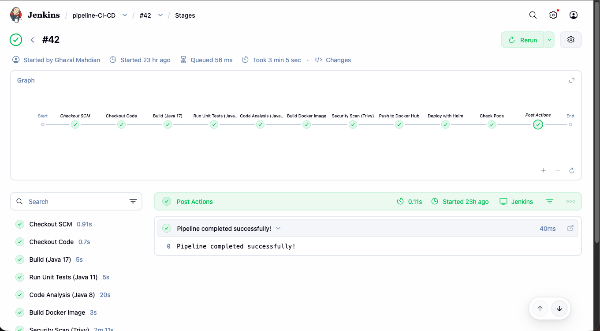
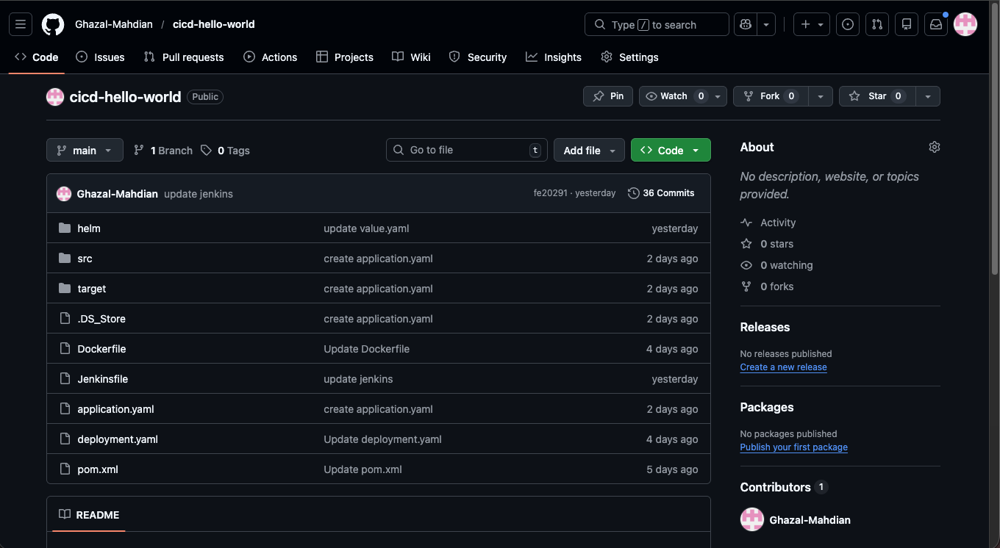
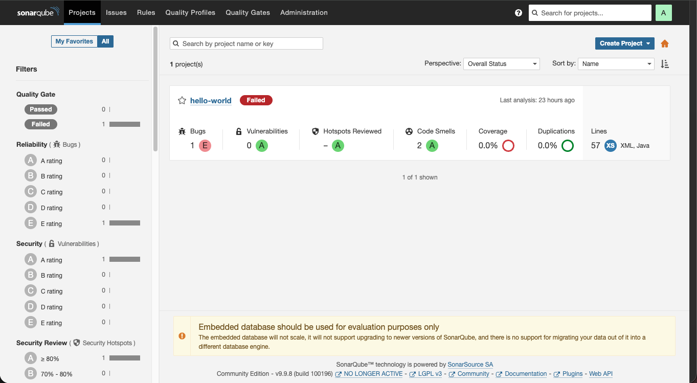
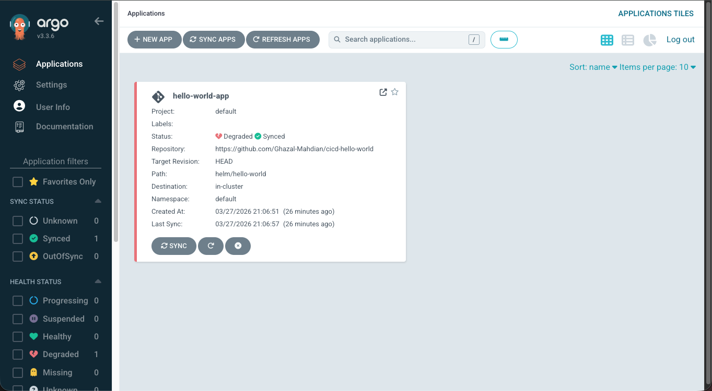
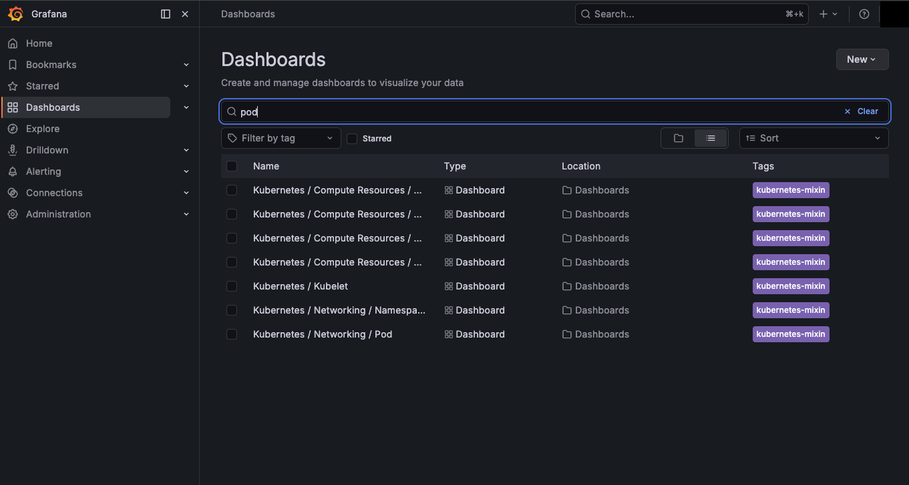

# CI/CD Pipeline: Jenkins, Docker, Kubernetes & GitOps

I built an end-to-end CI/CD pipeline for a Java application. Jenkins compiles, tests, and statically analyzes the code across three JDK versions, builds a Docker image, scans it with Trivy, pushes it to Docker Hub, and deploys it to Kubernetes with Helm. Beyond the core pipeline, I added GitOps delivery with Argo CD and cluster observability with Grafana.

**Source code:** [Ghazal-Mahdian/cicd-hello-world](https://github.com/Ghazal-Mahdian/cicd-hello-world)
**Stack:** Jenkins · SonarQube 9.9 · Docker · Trivy · Docker Hub · Kubernetes · Helm · Argo CD 3.3 · Grafana · Maven · Java 17/11/8



## Highlights

- **11-stage Jenkins pipeline** that runs green end to end in about 3 minutes (build #42).
- **Multi-JDK workflow:** build on Java 17, unit tests on Java 11, SonarQube analysis on Java 8.
- **DevSecOps:** SonarQube static analysis and a Trivy image scan before the image is pushed.
- **Kubernetes delivery with Helm**, and **Argo CD** syncing the same chart from Git for GitOps.
- **Observability:** Grafana with Kubernetes compute, kubelet, and networking dashboards.

## Pipeline Architecture

```
 VS Code ── git push ──► GitHub (cicd-hello-world)
                              │                         ▲
                              ▼                         │ watches helm/hello-world
 Jenkins pipeline-CI-CD                                 │
   Checkout ─► Build (Java 17) ─► Unit Tests (Java 11) ─► Code Analysis (Java 8) ──► SonarQube
   ─► Build Docker Image ─► Security Scan (Trivy) ─► Push to Docker Hub
   ─► Deploy with Helm ──► Kubernetes ◄── Argo CD
   ─► Check Pods ─► Post Actions                    └──► Grafana dashboards
```

| Stage | Duration |
|---|---|
| Checkout SCM / Checkout Code | 0.9 s / 0.7 s |
| Build (Java 17) | 5 s |
| Run Unit Tests (Java 11) | 5 s |
| Code Analysis (Java 8) | 20 s |
| Build Docker Image | 3 s |
| Security Scan (Trivy) | 2 min 11 s |
| Push to Docker Hub → Deploy with Helm → Check Pods → Post Actions | ✅ |

More detail: [docs/architecture.md](docs/architecture.md).

## Implementation

**Pipeline-as-code repository.** The Jenkinsfile, Dockerfile, Helm chart (`helm/hello-world`), Kubernetes manifests, and Maven project are all version-controlled. The repository has 36 commits.



**Static analysis.** The Code Analysis stage sends the project to SonarQube, which reports bugs, vulnerabilities, code smells, coverage, and duplication.



**GitOps.** Argo CD tracks `helm/hello-world` at `HEAD` and keeps the cluster in sync with Git.



**Observability.** Grafana with the Kubernetes mixin dashboards for compute resources, kubelet, and pod and namespace networking.



The application and project layout are in [docs/implementation.md](docs/implementation.md).

## Results

| Check | Result |
|---|---|
| Full pipeline run | ✅ 11/11 stages passed (3 min 5 s) |
| Build, test, analysis on three JDKs | ✅ Passed |
| SonarQube analysis | ✅ Completed: 0 vulnerabilities; quality gate flagged 1 bug and 0% coverage |
| Trivy image scan | ✅ Completed |
| Push and Helm deploy | ✅ Passed |
| Argo CD sync | ✅ Synced; app health reported Degraded |

Full results: [docs/validation.md](docs/validation.md).

## Key Takeaways

- **Make quality gates blocking.** SonarQube flagged the build, but the pipeline continued. Adding `waitForQualityGate abortPipeline: true` turns the gate from a report into a release control.
- **Measure coverage, not just tests.** Feeding a JaCoCo report into SonarQube would turn the 0% coverage figure into a real metric.
- **Pick one deployer.** With both Helm-from-Jenkins and Argo CD targeting the cluster, the clean GitOps pattern is for Jenkins to update Git and let Argo CD own the deployment.
- **Health needs an endpoint.** A long-running service with HTTP health checks gives Kubernetes and Argo CD meaningful readiness signals.

## Next Steps

- Enforce the SonarQube quality gate and add JaCoCo coverage.
- Fail the pipeline on high or critical Trivy findings.
- Move deployment fully to Argo CD (Jenkins commits the image tag to Git).
- Add readiness and liveness probes and resolve the Degraded health status.
- Replace the SonarQube embedded database with PostgreSQL.

## Repository Guide

| Path | Contents |
|---|---|
| [`docs/architecture.md`](docs/architecture.md) | Pipeline design, components, repository layout |
| [`docs/implementation.md`](docs/implementation.md) | Stage table, application source, SonarQube, Argo CD, Grafana details |
| [`docs/validation.md`](docs/validation.md) | Results for each stage and tool |
| [`docs/evidence-index.md`](docs/evidence-index.md) | Every claim mapped to its screenshot |
| [cicd-hello-world](https://github.com/Ghazal-Mahdian/cicd-hello-world) | Pipeline and application source |

---

© 2026 Ghazal Mahdian.
